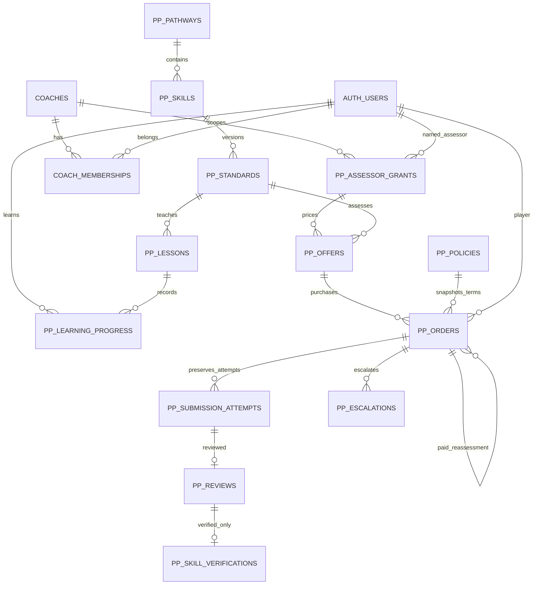
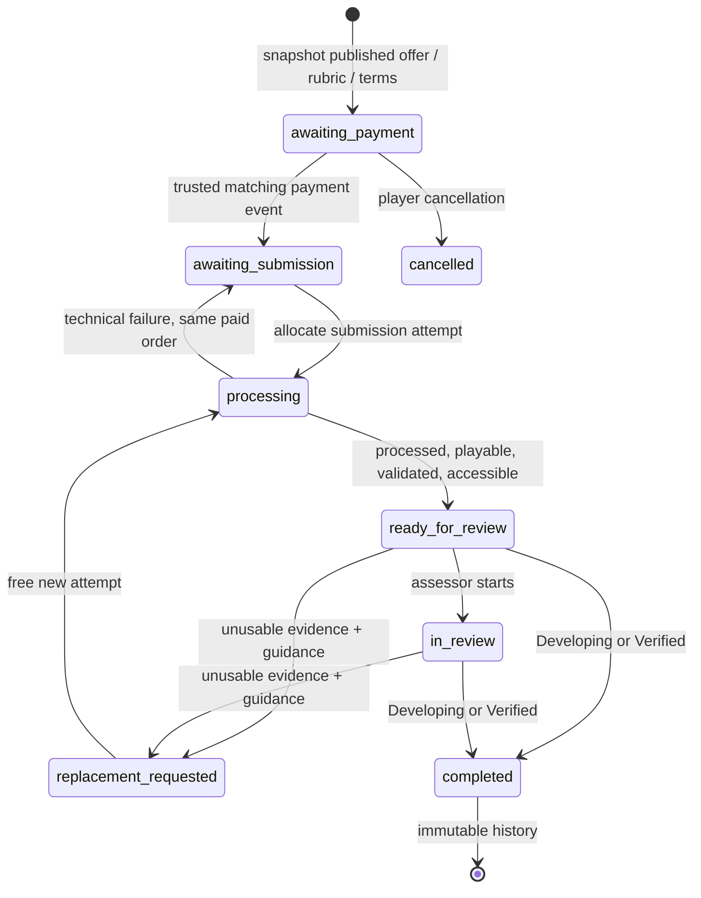

# Progress Passport — Phase B handoff

Implemented locally on 30 October 2026. Database and domain logic only. Phase A UI, routing, authentication, discovery, bookings, coach approval/publication and email services are unchanged. Nothing has been pushed, deployed, applied to Supabase or enabled for customers.

## Architecture and reuse

The initial tracked working tree on `master` was clean; Phase A was already committed. Unrelated untracked `backups/` and `design-system/` directories were preserved. The Supabase CLI's incidental `.temp/cli-latest` change was restored.

Reuse the existing `auth.users` identities, profiles, `coaches`, `coach_memberships` and `admin_memberships`. Existing `private.current_admin_role()` / `private.has_admin_permission(text)` determine operational admin access. A read-only production metadata inspection confirmed their current bodies match the test permission matrix. No production rows were read or changed for testing.

An approved coach is not automatically an assessor. Each grant names an individual existing user, a coach profile, and exactly one pathway or skill scope. Current coach approval, membership, explicit approved scope and verified credential review are all required. Private credential references are opaque workflow/document identifiers, not public storage URLs or official accreditation claims.

The existing booking `paid_at` field records off-platform session payments. It is not reused as an assessment payment ledger. Assessment orders model a distinct service and reference existing accounts/coaches. Existing booking tables and their transitions are untouched.

No new application dependencies. Supabase SSR clients/session checks and admin permissions are reused. New modules are `server-only` ordinary server modules, not Next Server Actions or HTTP routes. No provider keys, payment SDK, video SDK or new service-role client is created.

## Relationships

Private supporting tables: `pp_runtime` (closed release switch), `pp_requests` (actor-scoped idempotency), `pp_provider_events` (trusted-event idempotency). `pp_audit` records eligibility changes, publication, reviews, reassignments and resolutions without duplicating contact information or credential documents.

Three invoker-rights projections support later UI integration: `pp_passport_skill_records` (latest completed outcome, feedback next step, active verification count), `pp_passport_achievements` (traceable verified/revoked records), and `pp_overdue_assessments` (overdue queue). A later Developing assessment does not erase a still-valid earlier achievement. Clients can display latest assessment and existing verification separately.

## Local migrations and release safety

Created by the Supabase CLI, in this order:

1. `20261030222020_progress_passport_foundation.sql` — new tables, keys, constraints, private helpers, RLS, immutable provenance and read models.
2. `20261030222021_progress_passport_operations.sql` — transactional user/admin commands and separate service-only provider-event intake.
3. `20261030222023_progress_passport_draft_curriculum.sql` — four pathway names, two draft skills (rally and Improver Bandeja), three draft practice lessons and draft commercial proposal. No assessor, offer, payment or achievement is seeded.

No existing migration is edited. The migration files deliberately leave `private.pp_runtime.enabled=false`. Authenticated client mutations and provider events fail closed while it is false. There is no public RPC to enable it. Phase A's separate `PADEL_PASSPORT_PREVIEW` restrictions are unchanged and also guard every new TypeScript operation/read. Setting a UI environment flag cannot enable production assessment processing.

Before any staging application:

1. Review all three migrations and commercial/security assumptions in this handoff. Confirm the target is a disposable/staging database and migration history matches the repository. Do not use a forced history repair or skip missing versions.
2. Confirm PostgreSQL 15+ (invoker views), the existing `private` schema and the two admin permission helpers, `auth.users`, `coaches(id,is_approved)` and `coach_memberships(coach_id,user_id)` exist. These migrations do not redefine those production helpers.
3. Apply the new files in timestamp order using the project's normal reviewed Supabase migration process. This is an instruction for a later approved deployment, not an operation performed in this task.
4. Confirm all new tables have RLS, all client/worker direct writes are revoked, public wrappers are invokers, privileged helpers have empty search paths, and only `service_role` can execute provider-event intake.
5. Replay the lifecycle/security scenarios on the full staging schema with staging-only fixtures. Check Supabase Auth/PostgREST grants, existing lifecycle triggers, authenticated roles and concurrent requests. No production fixture testing is authorised by this handoff.
6. Keep the database switch closed and all standards/policies draft until release, policy approval and Phase C integration are reviewed. Rollback of a failed migration is transactional. Once records exist, use a forward corrective migration; do not drop historical orders/reviews to roll back.

Account deletion currently encounters restrictive Passport foreign keys when historical records exist. This intentionally prevents accidental destruction of financial/assessment history. An approved retention/anonymisation/deletion design must be added before live records are accepted; the existing account deletion journey is not being silently redefined as a permanent policy.

## Lifecycle

Admins may cancel an unfinished paid order or request a refund; both require an audit reason. Paid cancellation requests refund resolution but makes no transfer. A recorded refund never erases assessment feedback or silently revokes a legitimate skill. Explicit audited verification revocation is a separate command. Completed orders cannot be reopened or reassigned.

### Purchase and payment

The player selects an offer and a published policy; no client-supplied price or paid state is used. Price/currency, gross commission, coach earnings, rubric/evidence version and full terms are snapshotted. Monetary amounts are integer minor units. The draft proposal uses 20% and half-up rounding, but remains unpublished until an owner approves it. Offers are coach-set; £35 is a suggestion, not a seeded fixed price or charge.

Only the service-role event RPC can acknowledge a matching amount/currency and unique payment reference. User/admin commands cannot mark orders paid. There is no checkout, provider call or financial transfer. This foundation records full-payment/full-refund confirmations; partial refunds, fees, tax and disputes need an approved extension. Late payments after cancellation are rejected for manual/provider reconciliation in Phase C, not silently lost or automatically refunded.

Idempotency keys are mandatory: user commands are keyed by actor/request UUID and exact payload; provider events by source/event ID and exact payload. Replays return the original result. Reusing a key with different input is rejected. A payment reference cannot fund two orders. A final review is unique per order; a review is unique per attempt; a verification is unique per completed assessment/review. Repeated requests cannot create another outcome or turn a free retry into a charge.

All mutation RPCs share a short transaction-scoped advisory lock for this pilot, plus order row locks. This serializes eligibility changes, event/review delivery and idempotency. No network calls run while it is held. This deliberately conservative boundary needs load/concurrency testing; if volume warrants finer locks, replace it with ordered entity locks while retaining atomicity.

### Evidence and delivery

Upload, processing, validation, playable availability and review timestamps are separate. The service boundary enforces positive duration/size, an allow-listed video MIME type and the stricter of the snapshotted rubric/policy duration limits (never above 90 seconds). Provider references are nullable until bound and cannot change mid-attempt. Tests use `mock:` references; no fabricated live Cloudflare identifiers.

Technical failures retain the paid order and failed-attempt history. A new attempt does not create another order/payment. Unusable footage requires a reason and recording guidance and is preserved as a replacement review; it cannot deliver the professional assessment. Stale or out-of-order media events cannot revive prior attempts or change completed decisions.

Final reviews require meaningful observations, positive feedback, criterion verdicts, practice tasks and a specific next step. Developing must identify unmet criteria and areas to improve; it completes the paid assessment without creating verification. Verified requires every snapshotted criterion to be met. Verification is derived transactionally from that completed review, with matching player, skill, standard, coach and individual assessor provenance. Practice completion writes only learning progress.

### Clock and escalation

The draft default is a 72-calendar-hour target starting only when trusted validation reports playable evidence available to a currently eligible assigned assessor. Payment or upload completion alone starts no clock.

Policy versions configure replacement handling:

- `reset`: pause/remove the current deadline, then start a full target window once replacement footage is valid and available (draft default).
- `resume_remaining`: retain remaining seconds when replacement is requested, then resume that allowance after replacement validation. An already-overdue review resumes with zero allowance.

Both policies are tested. Reassignment does not restart the clock. Suspension after availability is an admin resolution/escalation concern; it does not auto-refund. Admins can open/resolve an overdue escalation. Timers never initiate refunds. Calendar versus business hours, compensation and timeout resolution need approval before publication.

Reassignment is deliberately limited to another explicitly eligible individual within the purchased coach profile. Cross-coach reassignment is rejected because it could change the commercial payee/contract. A future approved policy must address that case rather than silently changing immutable purchase terms.

## Permissions and RLS

- Anonymous users: no Passport table/view or mutation access.
- Players: read only their own orders, submissions, reviews, skill records and verifications; published curriculum/terms and active published-standard offers are readable. Self-reported learning progress remains separate. A player cannot assess a coach profile they manage.
- Assessors: private order/media access requires individual assignment, an approved scope, checked credentials, current membership and approved coach status. An unrelated coach or another member without the named scope cannot review. Suspension/revocation removes evidence access and ability to issue new decisions. Historical records remain available to the player and authorised admins.
- `profiles.manage` (existing owner/operations permission): assessor eligibility and standard publication/retirement. `team.manage` (owner): commercial policy publication/retirement. `bookings.manage`: sensitive review controls, escalations, refunds, cancellation and verification revocation. `audit.read`: audit access. Support/reviewer roles cannot grant assessor authority.
- Credential references: only the named assessor or authorised profile manager can read them. No bucket, document upload endpoint or public credential URL is introduced.
- Direct INSERT/UPDATE/DELETE grants are absent for authenticated and service roles. Guarded private definer functions own transitions. Public wrappers use invoker rights; function grants separate authenticated operations from trusted events. There is no generic arbitrary SQL or service client in the browser.

## Domain modules and Phase A integration points

- `lib/passport/types.ts`: explicit criteria, grant, offer, order, attempt, review and verification models plus typed command payloads.
- `lib/passport/operations.ts`: authenticated/admin-checked transactional command adapter. SQL remains authoritative for membership, scope, price, playable evidence and lifecycle checks.
- `lib/passport/queries.ts`: current-player-only Passport read model using the existing SSR client and RLS. It accepts no arbitrary player ID and includes feedback-linked next steps.
- `lib/passport/media.ts`: small provider-independent event/reference boundary.
- `lib/passport/providerEvents.ts`: dependency-injected trusted-event adapter; does not create a service client or expose an HTTP action.

Phase A is still entirely mock-backed. No calls were added to its provider or pages. In a later reviewed UI integration, map its stable skill slugs to `pp_skills`, bind lessons to explicit standard versions, replace mock practice state with the learning-progress command, use `loadOwnPassport` for history/achievements and use the current review's next step for recommendations. Preserve sample labels until real data and feature release are deliberately enabled.

## Validation and limits

The SQL regression file is `supabase/tests/progress_passport_lifecycle.sql`, with a minimal isolated baseline in `passport_disposable_harness.sql`. It exercises actual PostgreSQL grants, RLS, constraints and functions, not string-only SQL assertions. The baseline mirrors the existing admin matrix and its current production function bodies were inspected read-only. It intentionally does not replace or reproduce the entire Supabase Auth/storage/PostgREST stack.

To reproduce on a brand-new, empty disposable PostgreSQL 15+ database (never a shared database), use `psql -v ON_ERROR_STOP=1` with the harness file, the three migration files in order, then the regression file. The harness creates roles and baseline tables and therefore must not be run against an existing Supabase schema. Alternatively load the same files with an existing isolated PGlite development runtime. No PGlite dependency was added to the application.

Tests cover free technical retries, free unusable replacements, both clock policies, published/draft standards, completed Developing followed by a distinct paid reassessment, authorised verification, unauthorised and suspended assessors, player isolation, idempotency, tampered amounts/terms, full-refund recording, audited revocation, reassignment, escalation and preserved version/history. SQL tests roll fixture writes back; the test runtime is then discarded.

Docker was unavailable. These migrations have not been applied to a full local/staging Supabase stack, and real multi-session contention or signed provider webhooks have not been exercised. A reviewed staging replay, schema diff and security/performance advisor run against the new schema are release prerequisites. No live payments, media uploads, emails or assessment UI were exercised.

Validation results:

- TypeScript (`--noEmit --incremental false`): passed.
- Targeted ESLint (`lib/passport`): clean. Broader repository lint, excluding the pre-existing untracked backup/design directories: passed with 0 errors and 17 warnings in unchanged files.
- Full Vitest: 50 files / 439 tests passed, including 14 new server-boundary/read-model tests and all Phase A / existing regression tests.
- Isolated PostgreSQL: all three migrations loaded; 66 explicit lifecycle/security assertions and expected-denial probes passed, alongside the successful transition calls. The SQL fixture transaction rolled back.
- Production build and whitespace checks: passed. No tracked pre-existing application files changed.

The isolated baseline is intentionally narrower than the full application schema. These results make this a review/staging candidate, not authorisation to activate production. Re-run the full staging replay and advisors before release.

## Files added

- The three migration files named above.
- `supabase/tests/passport_disposable_harness.sql` and `supabase/tests/progress_passport_lifecycle.sql`.
- `lib/passport/types.ts`, `media.ts`, `operations.ts`, `providerEvents.ts`, `queries.ts`, `operations.test.ts` and `queries.test.ts`.
- `docs/progress-passport-phase-b.md` (this handoff).

## Decisions requiring approval and Phase C boundary

Before accepting any live footage or funds, approve:

1. Versioned curriculum/rubrics and who can verify assessor credentials/scope. The 10-character feedback checks are basic integrity checks, not a claim of coaching quality or official certification.
2. Coach-set pricing, supported currencies/minor-unit conventions, proposed 20% gross commission and rounding, fees/tax, refund/dispute policy and reassessment terms. No partial-refund or settlement policy is invented here.
3. Review target semantics, replacement clock choice, suspension/reassignment handling, prolonged replacement cases and overdue escalation responsibilities.
4. Player consent, minors/guardians, who can see footage, credential handling, maximum upload size, abuse reporting, retention/deletion/anonymisation and data region obligations. Restrictive history FKs require an agreed account-erasure implementation.
5. Verification expiry/correction, achievements/certificates, public sharing/consent and cross-coach financial reassignment.

Recommended Phase C: authenticated direct/resumable tus uploads behind the existing ownership boundary; short-lived scoped upload capability; signature-verified Cloudflare processing events with durable source-namespaced IDs and replay handling; trusted duration/type/size/playability validation; private signed playback for player/current eligible assessor/admin; retention/deletion jobs and failed-webhook reconciliation. Optional coach-response videos remain separate media with equivalent privacy. Payment-provider verification and checkout require a separately approved commercial integration; do not wire user commands to successful payment events.

No Cloudflare account/SDK, Stripe, live coaching, AI assessment or marketplace is activated. Stop at this Phase B handoff.
