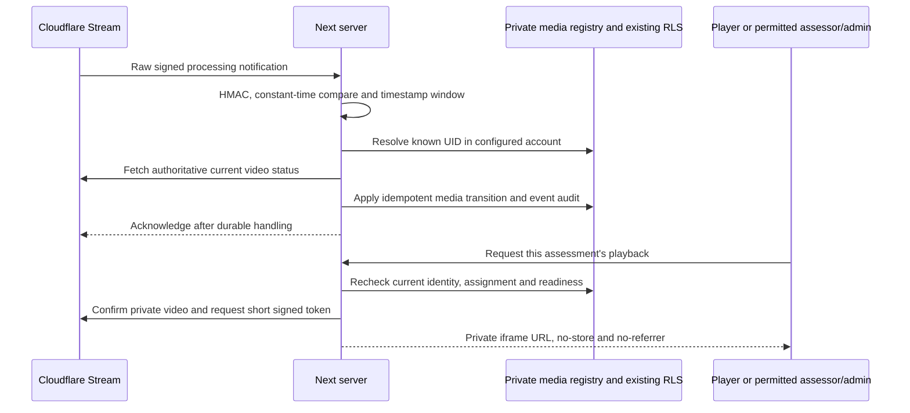

# Progress Passport — Phase C.2: Cloudflare Stream integration

3 November 2026. **Implemented for offline/local validation; Stream is not activated.** No live Cloudflare credentials, subscription, upload, webhook registration, playback or deletion was used. No production migration/configuration/data change, deployment, push or merge. Stop after C.2.

## Repository and release boundary

Read the Phase A/B/B.1/local Supabase/C.1 handoffs and inspected `master`, existing pending work, authentication, actor/worker RPCs, RLS, financial transitions, video interface and installed Next route-handler guidance. Preserved C.1's four tracked modifications and all earlier untracked files, including unrelated backups/design work. The only new dependency is pinned `tus-js-client@4.3.1`; no existing locked package version was changed. Unrelated npm lockfile metadata churn was removed.

Existing coach/venue discovery, booking, application approval, authentication and email implementations are unchanged. Existing paid-order/assessor rules remain authoritative. New media integration uses the existing order, player, coach and submission-attempt records; it does not duplicate those domain tables.

The adapter speaks the actual documented API. Activation remains deliberately **local-development-only**: the existing development preview flag, explicit server Stream flag, exact local Supabase address and all required credentials must pass. Production/Vercel remains unavailable even if an environment flag is accidentally set. The database release gate is independently disabled by default; this migration never opens it. A later reviewed production release change is necessary, not just a browser setting.

## Architecture and endpoints

New private `pp_stream_sessions` binds a server-generated session UUID, player, order, active attempt, declared file fingerprint/size/type, purchased duration limit, Cloudflare account and provider-issued UID. The short-lived upload capability is AES-256-GCM encrypted, authenticated to the session UUID. Private audit rows record actions/event hashes without webhook bodies, filenames, capability URLs, payment references or provider diagnostics. Client and service-role direct table writes are revoked; narrow actor/worker RPCs own mutations.

Actor reservation and worker claim are separate transactions. A database claim permits one external creation call, outside locks. Different concurrent requests for the same allowed file reuse the active reservation. Ambiguous creation is marked uncertain, never automatically POSTed again. Reconciliation searches the configured account by the non-PII session creator ID; an expired unbound permission can fail into a free new attempt while its durable record remains available for orphan cleanup.

- `POST /account/development/assessments/[orderId]/upload-session`: existing SSR authentication, player ownership, same-origin check, funding/refund/state checks, configured size/type constraints; actor RPC reserves, worker provisions/binds. Returns only the necessary short-lived upload capability/status. No video bytes traverse Next/Vercel.
- `POST .../upload-session/status`: same authenticated player, server-retrieved active session; re-fetches provider processing metadata. The browser cannot assert readiness.
- `DELETE .../upload-session`: owner-authorised, unfinished-upload cancellation. SQL marks the attempt failed without changing payment; provider revocation is attempted for that owned record. An outage leaves an audited deletion queue for retry. Repeated cancellation is idempotent.
- `GET .../playback`: current RLS checks on order and attempt, exact stored provider binding, ready private video check, then short-lived signed iframe access. Never accepts a caller-provided video UID.
- `POST /api/passport/stream/webhook`: bounded raw body; official signature verification before UID lookup/provider calls; configured-account session ownership and fresh provider GET; transactional, idempotent state application.
- `POST /admin/passport/media`: explicit active-admin `deletions.manage` check at both route and service, same-origin check, bounded JSON cursor. Reconciles one page of 50 configured-account records and retries authorised cleanup. Returns counts and a cursor, never private video links. No cron/subscription was installed.
- `queuePlayerStreamErasure(playerId, reason)`: server-only, existing deletion-admin permission and explicit reason. Prepares the media side of an approved account-erasure workflow; it does not silently delete users, financial records or historical assessments.

The original local mock POST/GET remains available for C.1 automated UI tests. Server-selected mode and size limit are the only configuration passed to the client. API keys and encrypted capability material never become React props.

## Upload sequence

```mermaid
sequenceDiagram
  participant P as Authenticated player
  participant N as Next server
  participant D as Supabase actor and worker RPCs
  participant C as Cloudflare Stream
  P->>N: Declare file and stable resume fingerprint
  N->>D: Check owner and funding; reserve active attempt
  D-->>N: Durable session and single creation claim
  N->>C: Create tus permission with duration, expiry and signed playback
  C-->>N: Location capability and stream-media-id
  N->>D: Bind UID and encrypted capability
  N-->>P: Authorised short-lived upload URL
  P->>C: tus HEAD and PATCH directly, resumable offsets
  P->>N: Request processing status
  N->>C: Fetch actual video metadata
  N->>D: Apply accepted processing/ready transition
  D-->>N: Valid media starts review clock once
  N-->>P: Ready or recoverable status
```

## Webhook and playback sequence



## Provider and mobile behaviour

Provisioning uses authenticated `POST /accounts/{account}/stream?direct_user=true` with tus 1.0.0, exact Upload-Length and Upload-Creator. Initial Upload-Metadata includes the purchased duration (never above 90 seconds), `requiresignedurls` and an upload expiry. Provider UID comes from `stream-media-id`, not URL parsing. The returned capability must be HTTPS on the documented upload host; other hosts fail closed.

The maintained tus client uses 5 MiB chunks, documented alignment, bounded retries and the server-created upload URL without an endpoint fallback or API credentials. Pause uses `abort(false)` and keeps the remote upload; explicit cancellation uses the actor-authorised DELETE flow. Local storage holds only a request UUID and bounded file fingerprint, never a capability, provider token or filename. After refresh/reconnection, reselecting the same file retrieves an authorised session and tus HEAD resumes the accepted offset. Private browsing may limit recovery to the current page.

MP4, MOV and WebM selection is retained. A MOV that this browser cannot preview may still be sent to Stream for authoritative decoding; this does not bypass provider duration/size checks. The current default cap is 50 MiB, configurable up to the database's 512 MiB safety ceiling. Upload permissions expire after 15 minutes; expiry is not a new payment. Processing may continue after that deadline once the provider has accepted the upload. The first live mobile tests must validate realistic file sizes, duration, network speed, expiry and codecs before changing these technical defaults.

Browser/OS suspension, closed tabs, terminated phones and camera/file permissions are not guaranteed background-upload environments. No physical iPhone/Android test was performed. A selected file must generally be reselected after navigation; this implementation does not retain native file handles.

## Processing, financial integrity and playback

The signature is HMAC-SHA256 over the official `timestamp + '.' + raw bytes` input with a five-minute past/future tolerance and constant-time comparison. Bodies are limited to 64 KiB. Unknown/mismatched UID/account/creator records are rejected. No subscription is registered or overwritten.

The webhook body supplies a lookup UID, not trusted media state. Provider GET must confirm the same creator/session and private playback setting. A ready transition requires `readyToStream`, ready state, decoded dimensions, positive duration within the purchased limit and acceptable provider-reported size. Declared MIME is retained as an informational upload type; provider video processing establishes playability. No browser-supplied metadata can confirm payment or make a video reviewable.

The original provider-event RPC performs funding, active-attempt, refund and current assessor checks and starts the clock only on valid readiness. Late/duplicate events cannot reopen completed attempts or reset the deadline. A technical failure or unusable-footage replacement retains the original order/payment; a later reassessment remains a new parent-linked order awaiting funding. Developing delivers the paid service, without automatically awarding Verified.

New SQL media guards prevent a competing producer changing a bound UID and prevent new coach decisions after media deletion has been queued. Deleting media does not rewrite existing review/verification provenance. No original downloads are enabled.

Signed playback uses the documented token endpoint with `downloadable:false`, original access disabled and a **120-second** expiry. Current RLS is checked on every issue/renewal; the UI renews at 90 seconds and removes playback if access is denied. **Previously issued bearer tokens can remain usable until expiry.** New access is denied immediately after relevant permission loss; instant revocation of an already copied token is not claimed. Client approval of this bounded exposure, or an additional edge-authorisation design, is required before live release. Renewal can reload the iframe; live UX tests must cover paused/replayed clips.

## Environment checklist

All of these are **server-only**, except the existing public Supabase URL/key convention. Do not prefix secrets with NEXT_PUBLIC.

- `PADEL_PASSPORT_PREVIEW=true`: existing local development preview guard; production/Vercel stays closed.
- `PADEL_PASSPORT_STREAM_ENABLED=true`: explicit local Stream opt-in. Leave unset/false now.
- `NEXT_PUBLIC_SUPABASE_URL=http://127.0.0.1:55321` and the existing local publishable-key variable for isolated testing.
- `PADEL_PASSPORT_STREAM_SERVICE_KEY`: generated local service-role key, explicitly supplied; no fallback to an existing hosted project's key.
- `CLOUDFLARE_ACCOUNT_ID`: configured account ID.
- `CLOUDFLARE_STREAM_API_TOKEN`: account-scoped Stream permission token, held by the server only.
- `CLOUDFLARE_STREAM_WEBHOOK_SECRET`: official subscription signing secret, not the API token.
- `CLOUDFLARE_STREAM_CUSTOMER_CODE`: customer code used to construct the signed player host.
- `PADEL_PASSPORT_STREAM_CAPABILITY_KEY`: random 32-byte key, standard base64, for AES-GCM capability encryption. Rotate with an explicit in-flight-session recovery plan.
- `PADEL_PASSPORT_VIDEO_MAX_BYTES`: optional; default 52428800, maximum 536870912. Does not alter the 90-second limit.
- `PADEL_PASSPORT_STREAM_RETENTION_APPROVED`: leave false/unset until client approval.
- `PADEL_PASSPORT_STREAM_RETENTION_VERSION`: required approval/version identifier when retention is enabled.
- `PADEL_PASSPORT_STREAM_RETENTION_DAYS`: required JSON with `unfinished`, `failed`, `replaced`, `completed`; each value is approved positive days or explicit null. No implicit retention clock.

For mock mode, retain the documented C.1 `PADEL_PASSPORT_MOCK_VIDEO`, local worker and FFprobe configuration. Missing Stream credentials never activate a live provider. No existing environment file or hosted setting was modified.

## Retention proposal — requires client approval

No period below is installed as a default. Proposed starting points for discussion: unfinished uploads 1 day after last session transition; failed/corrupt files 7 days; replaced footage 14 days after its replacement decision; completed assessment media 90 days after completion. Pending professional reviews are held regardless of the unfinished policy. New reconciliation transitions are reclassified on a fresh maintenance pass before applying retention.

Agree consent, safeguarding/minors, dispute/review needs, maximum wait/overdue handling, retention extension/holds, completed-record anonymisation and erasure verification before approval. Optional future coach-feedback videos need their own consent/retention rules and are not implemented here. Financial/assessment history is separate from media erasure; its policy must not be inferred from these proposed video windows.

Deletion is queued/audited before the external call, checks the configured-account UID/creator binding, treats a missing provider object as already removed and retains retryable errors. Unknown creations are discovered only through that session's creator ID; no broad account-wide deletion is allowed. Cleanup pagination prevents old retained rows starving later records. No unattended cleanup schedule was installed. A reviewed operator/job schedule and completion monitoring are prerequisites for live activation.

The existing account-deletion workflow must invoke the approved media-erasure queue and confirm provider completion before claiming account media has been erased. Connecting that workflow, history anonymisation and final retention sign-off remain activation dependencies; no existing account deletion was silently changed.

## Migration, findings and validation

One additive CLI-created pending migration: `20261103080457_progress_passport_stream_sessions.sql`. It follows the three existing Phase B files and changes no applied historical migration. The isolated workspace replays the schema-only test bootstrap plus all **21 repository migrations: 22 local entries**. No customer backup data is imported. The guarded launcher verifies the dedicated project/Docker identity and actual loopback bindings; the database gate is temporarily opened only for synthetic tests and disabled in cleanup.

The five recorded legacy `security_definer_view` ERRORs remain: `coach_public_profiles`, `venue_public_profiles`, `coach_public_reviews`, `coach_relationship_identities`, `venue_relationship_identities`. They expose selected public/member identity fields and must never authorise private assessment media. C.2 uses existing Passport RLS/current grants instead. None was rewritten. Explicit review/acceptance or a separate remediation remains necessary before production activation.

Local advisors report the same five ERRORs and 27 legacy warnings, with **no new Stream ERROR/WARN**. Stream informational findings include intentionally deny-all private tables, new/unused indexes and a composite-FK index recommendation: `attempt_id` is already unique, so the existing index bounds that FK lookup to at most one row. No redundant index was added solely to silence the informational recommendation.

Production-package audit: **one critical and two high package-level findings**, also present against the original lockfile, in `next`, `sharp` and `source-map-js`. The pinned tus dependency adds no reported production finding. Existing package versions were not upgraded opportunistically. In particular, the [reviewed Windows Next.js advisory](https://github.com/advisories/GHSA-p293-qw3h-jr36) includes the installed 16.3.2 version. Framework/transitive remediation and regression testing are release blockers. Full development-dependency audit also has existing findings; the production-only comparison above is not a clean bill of health.

Validation performed:

- Full Vitest: **57 files, 507 tests pass**, including 41 C.2 tests covering official response-shaped fixtures, creation/claims, missing credentials, capability encryption/session binding, raw signatures/timestamps, replay/out-of-order processing, duration/size, MOV/MP4 selection, expired permissions, pause/resume, private playback, RLS/owner denial, admin deletion controls, retention holds and cleanup errors.
- A real `tus-js-client` transfer against a loopback HTTP fixture server loses its first PATCH response after acceptance. A fresh client HEAD resumes from 5 MiB, transfers only the remainder and produces byte-identical output. This tests tus behaviour, **not Cloudflare**.
- Complete local Supabase replay, Stream actor/worker SQL tests and **21 separate-connection concurrency groups** (17 original plus 4 Stream groups): duplicate reserve/claim/readiness; cancellation/readiness; deletion/review; expiry/free retry. Original financial, Verified, refund, assessor suspension, RLS and legacy regressions remain covered. New tests caught and corrected stale replacement-session reuse and a maintenance-query PL/pgSQL alias ambiguity.
- Real local GoTrue/JWT/signup/SMTP confirmation/login/refresh/recovery, HTTP RLS/Storage tests and seven legacy SQL regressions run through the existing validator. No external email or live payment was sent.
- TypeScript and production build pass; targeted lint is clean. Repository lint: 0 errors and the same 17 pre-existing UI warnings.
- C.1 real-browser mock regression passes at 320px and 390px: real SSR login, selection/validation, interrupted upload/retry, private ranged playback, free replacement, assessor suspension and Developing/reassessment isolation. Sanitised database/browser evidence accompanies this handoff. This exercises the retained mock UI path, not a live Stream browser or physical device.
- Final review tightened playback expiry validation: missing, non-integer, expired or overlong provider token claims fail closed. All 41 Stream tests, TypeScript and targeted lint pass after this change.
- Final guarded reset leaves zero test users, orders or Stream sessions, 22 local migration entries and the release switch disabled. All 21 repository migration hashes match the replay. Published ports were verified on 127.0.0.1 only; the isolated stack is now stopped.

## Manual activation checklist — not performed

1. Resolve dependency advisories and legacy security sign-off; approve retention/consent, assessor/financial policies and the signed-token revocation window. Review the new migration and account-erasure/cleanup integration.
2. Obtain explicit approval for Stream account/billing activation and any test spend. Scope credentials to the intended account, supply them server-side and first use isolated synthetic or explicitly consented videos. This code never subscribes to billing or creates API tokens.
3. For first local live-wire tests, keep the isolated Supabase stack loopback-only, use approved synthetic funded fixtures, and test direct tus transfer plus authenticated polling. A webhook is not required to prove polling. Do not publish local Supabase or unrelated dev services.
4. Inspect the account's existing webhook subscription with the official read API. **Only one subscription is permitted. Do not PUT/overwrite an existing subscription without explicit approval.** A future callback should be a narrowly scoped secured HTTPS endpoint with this raw-body signature check, not a tunnel exposing the entire local stack. No such public endpoint/tunnel was created here.
5. Verify actual Location host/header behaviour, provider expiry, MOV/MP4/HEVC processing, original size semantics, max-duration rejection, private raw-UID denial, short token expiry, webhook signatures/retries, permission loss and owned deletion/orphan recovery. Confirm no original-download access. Test real iPhone/Android interruption, re-selection, slow networks and browser suspension; do not promise background upload after closure.
6. Confirm deletion completion/monitoring for every test asset and destroy test permissions/credentials as appropriate. Keep all production flags/database gates closed.
7. Only after separate release approval, design the intended protected staging/production gate, apply reviewed pending migrations to the confirmed target in order, wire approved operational scheduling/account erasure and deploy through the normal reviewed process. C.2 does not relax the existing local-only production guard or perform these steps.

## Files changed in C.2

- `lib/passport/video/stream/`: configuration/errors, official REST adapter, capability/signature crypto, durable lifecycle/service, HTTP boundaries, tus browser adapter, maintenance/erasure operations and five test files.
- `components/development/VideoSubmission.tsx`, new `StreamPlayback.tsx`: same player journey, server-selected provider, resume/status/cancel and private player.
- `lib/passport/video/localConfig.ts`, `queries.ts`, `validation.ts`; assessment `[orderId]/page.tsx`.
- New assessment `upload-session`, `upload-session/status`, `playback` handlers; signed webhook handler; explicit-admin maintenance handler.
- New migration and `supabase/tests/progress_passport_stream.sql`; existing local validator/concurrency tooling extended for current migration count and Stream races.
- `package.json` / lockfile: pinned tus client and its required transitive entries only.
- This handoff and sanitised C.2 evidence. Earlier phase work remains uncommitted and preserved.

**Remaining release blockers:** live-provider/physical-phone tests, existing dependency advisories, legacy view sign-off, approved privacy/retention and token policy, account-erasure integration, scheduled maintenance/monitoring and an explicitly reviewed production release. No Phase D work follows automatically.
